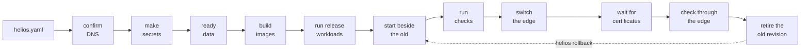
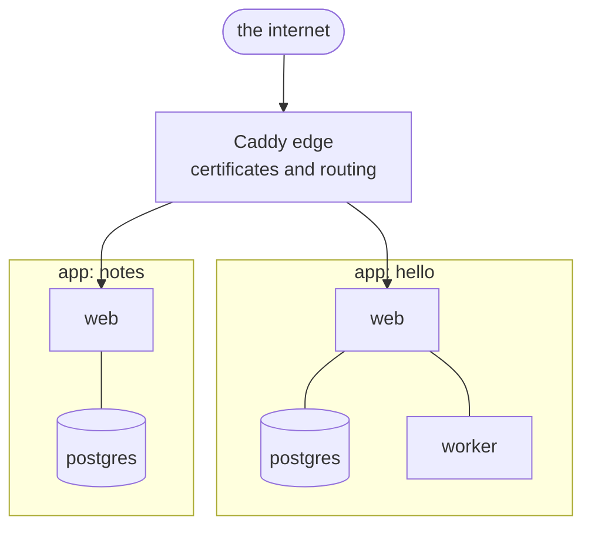

<div align="center">


# Helios

**One small program that runs your machines.**

Builds, certificates, secrets, backups, health checks and alerts.<br>
Everything a server needs for the apps it hosts, from a single static binary.

<a href="https://github.com/kylebegeman/helios/releases/latest"></a>
<a href="https://github.com/kylebegeman/helios/actions/workflows/ci.yml?query=branch%3Anext"></a>

<a href="./LICENSE"></a>

[Quick start](#quick-start) · [Manifest](#an-apps-manifest) · [Isolation](#how-apps-are-kept-apart) · [Deploys](#deploying-without-a-pipeline) · [Backups](#backups-that-restore) · [Commands](#commands) · [Docs](#status-and-docs)

</div>

<br>

## Renaming to Helios

Helios is the new name for Bedrock. The source module and primary command are
now `helios`; `bedrock` remains a compatibility entrypoint. New projects use
`helios.yaml`. Existing `bedrock.yaml` files are supported; if both defaults
exist, select one with `--manifest` or remove the duplicate.

This source rename preserves the Bedrock installation layout, service names,
Docker resources, sealed credentials and backup identities. Both commands
use the same state and daemon. `HELIOS_*` configuration variables are accepted
alongside their `BEDROCK_*` aliases; conflicting values are refused unless an
explicit corresponding flag overrides them. Workloads receive both sets of
app, workload and revision metadata variables.

The GitHub repository and live release channel still use the Bedrock URL until
the separately planned cutover. Release builds produce Helios assets and
identical legacy-named assets for older upgraders. See the
[migration plan](docs/operations/helios-rename-plan.md) for the staged rollout.

## Why Helios

- **One binary, nothing to install underneath.** A static Go binary installs and operates the whole machine. There is no agent to babysit, no runtime to keep current, and no control plane to pay for.
- **The manifest is the entire interface.** An app describes itself in `helios.yaml`. Everything else follows from that file: DNS records, certificates, secrets, data services, health, backups and alerts.
- **Isolation you get by default, not by remembering.** Read-only root, no Linux capabilities, no privilege escalation, a non-root user, and a private network per app. The manifest holds the explicit ways out, and `helios exposure` shows what each container really got.
- **Backups that are proven rather than hoped for.** Every backup is quiesced and consistent, and `helios drill` restores it beside the app, starts the app on it and verifies it on a schedule.
- **No pipeline required.** `git push helios main` deploys and streams every step back. A push whose deploy fails is refused, so the branch on the machine is always what runs.

## How a deploy works



The old revision is retained. `helios rollback` brings it back when the data
compatibility contract permits it; unsafe data transitions require an explicit
checkpoint restore. Every container receives `HELIOS_APP`, `HELIOS_WORKLOAD` and
`HELIOS_REVISION`, along with the corresponding `BEDROCK_*` aliases.

## Quick start

```sh
helios host setup                 # prepare a fresh Ubuntu or Debian machine
helios integration set cloudflare # DNS records for your hosts
helios integration set storage    # Backblaze B2 or any S3 store, for backups
helios integration set email      # SMTP, for alerts

mkdir my-app && cd my-app
helios init my-app --host app.example.com  # write a starting helios.yaml
helios deploy .                   # build, check, switch the edge
helios status                     # health, traffic, errors, backups

helios launch https://github.com/you/site --host site.example.com  # or from a repository
```

Helios needs Ubuntu 22.04 or 24.04, or Debian 12 or 13, on x86_64 or aarch64.

## An app's manifest

An app describes itself in `helios.yaml` at the root of its source.
`helios init` writes a commented one for the shape you are building, so a
new app never starts from a blank file:

```sh
helios init blog --kind static --host blog.example.com
helios init api --host api.example.com --postgres
helios init mailer --kind worker
helios init nightly --kind cron --schedule "0 4 * * *"
```

It only writes a file; nothing on a machine is touched. What it writes is
parsed and validated before it reaches disk, so a generated manifest always
loads. Here is one in full:

```yaml
app: hello
description: What this is for
owner: personal
workloads:
  web:
    kind: web              # web, static, worker, cron or release
    build: {context: .}    # or image: ghcr.io/you/hello:1.2
    port: 8000
    routes:
      - host: hello.example.com
        dns: direct        # helios keeps the Cloudflare record (or proxied)
      - host: example.com
        path: /hello       # a prefix; longest wins on a host
    env: {GREETING: hello}
    secrets: [API_KEY]     # names only; values live in helios's store
    health: {path: /healthz}
    resources: {memory: 256m, cpus: 0.5}   # memory defaults to 2g
    tmpfs: [/app/.cache]   # writable in memory; the root filesystem is read-only
    # user: "1000:1000"    # default: the image's user, or nobody for a root image
    # capabilities: [NET_BIND_SERVICE]     # default: none at all
    # writable_root: true  # the explicit way out of a read-only root
    # privileged: true     # for the rare workload that runs containers
  site:
    kind: static
    dir: public            # served by a file server
    routes: [{host: www.example.com}]
  nightly:
    kind: cron
    image: alpine:3.21
    schedule: "0 2 * * *"  # five fields, UTC
    command: [sh, -c, "echo tidy"]
    mounts: [{volume: files, path: /files}]
data:
  postgres: {version: "16"}  # DATABASE_URL reaches every workload
  volumes:
    files: {description: What people upload}
backup:                      # optional; an app with data is backed up
  schedule: "0 3 * * *"      #   nightly at 03:00 UTC (the default)
  drill: "0 4 * * 0"         #   restored and verified on Sundays (the default)
  keep: {daily: 7, weekly: 4, monthly: 6}
  verify: {sql: select count(*) from posts, at_least: 1}
checks:
  - url: https://hello.example.com/
    contains: hello
```

<details>
<summary><b>A larger app, with releases, singletons and derived secrets</b></summary>

<br>

An app with several parts, such as Loom's Core, uses a few more fields:

```yaml
app: core
workloads:
  api:
    kind: web
    build: {target: server}      # workloads built alike share one image
    port: 4773
    routes:
      - host: core.example.com
        path: /api
      - host: runners.example.com
        port: 4774               # a route may reach another port
    aliases: [control]           # more names on the app's network; "api" is one
    singleton: true              # never two at once: the old one stops first
    grace: 60s                   # time to stop before it is killed (10s)
    secrets: [API_DATABASE_URL]
  worker:
    kind: worker
    build: {target: server}
    health:
      command: [node, bin/ready.js]   # run inside; exit 0 means ready
      timeout: 5m
    resources: {pids: 2048}
  migrate:
    kind: release                # runs once per deploy, before anything starts
    order: 1                     # lower first, then by name
    build: {target: server}
    command: [node, bin/migrate.js]
    secrets: [MIGRATION_DATABASE_URL]
    timeout: 10m
data:
  postgres:
    version: "17"
    image: pgvector/pgvector:0.8.0-pg17   # default postgres:<version>-alpine
    user: core_admin             # the superuser; default the app's name
    database: core
    init: deploy/postgres        # first-run scripts, from the source
    secrets: [API_PASSWORD]      # given to the first-run scripts
    database_url: false          # no automatic DATABASE_URL
  objects: {}                    # a MinIO of the app's own at {objects}:9000
secrets:
  generate:                      # made once, when missing
    API_PASSWORD: hex:32         # hex, base64 or base64url of N bytes; value:TEXT
  derive:                        # made again whenever a source changes
    API_DATABASE_URL: "postgres://core_api:{API_PASSWORD}@{postgres}:5432/core"
    MIGRATION_DATABASE_URL: "postgres://core_admin:{BEDROCK_POSTGRES_PASSWORD}@{postgres}:5432/core"
```

Generated and derived values stay on the machine; only their names appear
anywhere. `{postgres}` and `{objects}` are the data services' names on the
app's network, the object store's root user is `MINIO_ROOT_USER` and
`MINIO_ROOT_PASSWORD`, and `{sha256:NAME}` is the hex SHA-256 of a secret.
A release that fails stops the deploy before anything new starts. A
singleton that fails to come up is replaced by its predecessor again. A
backup holds the database, every volume, the object store's files and the
first-run scripts, so a restore on a new machine rebuilds the same roles
before it loads the dump. `helios run --secret NAME` gives a one-off command
one more secret, and `helios run --stdin` hands it this terminal's input
without recording it anywhere.

One source can hold several apps, such as a product and a worker that runs
other people's code apart from its data: `helios deploy <dir> --manifest
helios.worker.yaml` deploys the other one, and `helios secret copy <app> NAME
<other-app>` gives it a secret the first made, without showing it.

</details>

<details>
<summary><b>A port on the machine itself, past the edge</b></summary>

<br>

Traffic that isn't HTTP on a hostname, such as Headscale's STUN, is published
on the machine's own address instead of routed through the edge:

```yaml
app: headscale
workloads:
  server:
    kind: web
    image: headscale/headscale:0.26
    port: 8080
    routes: [{host: hs.example.com}]
    singleton: true              # required: two copies can't hold one port
    ports:
      - port: 3478               # the container's port
        protocol: udp            # tcp (the default) or udp
        # host_port: 3478        # the machine's port; default the same
        # address: 203.0.113.4   # one of the machine's addresses; default all
```

Only web and worker workloads publish ports, and only as singletons: a deploy
starts the new container beside the old one, and the two can't hold one port,
so a singleton's old container stops first. 22, 80, 443 and 5000 are the
machine's own. A port another app on the machine already publishes is refused
while the deploy is still a plan, and the plan lists what it will publish.
One-off jobs, drills and previews publish nothing.

Docker opens a published port ahead of ufw's rules, so the firewall neither
opens nor closes it: anyone can reach it. Deploys don't change the firewall,
so add the rule yourself, once, on the machine:

```sh
ufw allow 3478/udp
```

That rule changes nothing about what is reachable; it makes `ufw status` say
what is open. `helios doctor` lists every port an app publishes on a public
address, and warns about one ufw has no rule for, or allows only from some
sources, since Docker publishes it to everyone either way. To keep a port off
the internet, give it a private `address`; ufw can't narrow it.

`helios host setup --web-from cloudflare` does not cover published ports.
Its guard holds 80 and 443 alone, so a published port still answers anyone
who knows the machine's address, and the doctor says so beside each one.

</details>

## How apps are kept apart

Each app runs as if it were alone on the machine.



Its workloads share a network with each other and its database; the ones that
serve traffic also share a network with the edge, and with nothing else. No app
can reach another app's containers or database, or the edge's admin API, which
is a socket only the machine reaches.

| Default | What a workload gets |
|---|---|
| **User** | the image's user, or `nobody` when the image would run as root |
| **Capabilities** | none at all |
| **Privilege escalation** | refused |
| **Root filesystem** | read-only, with `/tmp` in memory |
| **Memory** | 2 GiB |
| **Processes** | 4096 |

The manifest fields above are the explicit ways out, and `helios exposure`
shows each container as Docker runs it: its user, privileges, root filesystem,
networks, published ports and mounts, and anything that shares a network it
shouldn't.

## Deploying without a pipeline

A route with `dns: direct` or `dns: proxied` gets its Cloudflare record from
the deploy, which refuses a record that points at another machine; `helios
dns point <host>` moves one on purpose. Retiring a route, or the app, removes
its record. `helios dns` explains every host; `helios dns audit` finds
records that point here with nothing routed, and `helios dns drop <host>`
deletes one: only the A and AAAA records at exactly that name, only when
each points at this machine, and only when no app here routes the host. A
wildcard goes only when it is named itself.

An app is told who its visitor is in `X-Forwarded-For` and `X-Real-IP`: one
address each, whatever the request claimed. Behind Cloudflare's proxy that
is the visitor Cloudflare names, believed only on connections from
Cloudflare's own ranges, which `helios host setup` keeps on every machine.

A proxied record hides the machine's address, but only until someone learns
it. `helios host setup --web-from cloudflare` makes that not matter: only
Cloudflare's proxy may reach 80 and 443, so the address answers nobody else
on the web. Setup reads Cloudflare's published ranges and allows them in ufw
before it removes the open rules. Docker forwards the edge's published ports
past ufw, so setup also puts a guard in Docker's `DOCKER-USER` chain, run
again at every boot before Docker starts. It keeps a copy of the ranges in
`/etc/helios` for when the list can't be read, and `helios host
reconcile` keeps it current. Every route must
then be `dns: proxied`: setup refuses while an app routes a host any other
way, and `deploy`, `rollback` and `dns point` refuse to add one. SSH stays
reachable, keys only. Running setup again keeps the setting unless
`--web-from` is given, and `--web-from anyone` opens the web again. The guard
covers 80 and 443 only: a port an app publishes on the machine with `ports:`
stays open to anyone, and `helios doctor` says so.

`helios git allow <app> <public key>` lets a key push that app and nothing
else. Then, from the app's checkout:

```sh
git remote add helios bedrock@<machine>:<app>.git
git push helios main        # deploys, and streams every step back
```

A push whose deploy fails is refused, so the branch on the machine is what
runs. `helios deploy . --to bedrock@<machine>` sends a working tree the same
way, commit or not. `helios git webhook <app> --repo git@github.com:you/app.git`
deploys when GitHub says the branch moved, with a deploy key and secret
helios makes and shows once.

`helios launch <repository> --host <hostname>` takes a repository from
nothing to running: it fetches the branch, works out what the source is (a
Dockerfile, or a built site), writes the manifest it is missing and deploys
it. What it guesses is deliberately narrow; anything else is refused with a
suggestion.

`helios preview up <repository> --branch <branch> --domain preview.example.com`
runs a branch as its own app beside the one it is a branch of: a derived
name, its own containers and an empty database, at hostnames under the
preview domain, with every route behind a sign-in (`auth: loom`, below).
Pushing the same branch again updates it; `helios preview ls` lists them,
`helios preview down <preview> --data` removes one and its data.
Use `helios preview pin <preview>` to retain a branch, then review
`helios preview prune --older-than 7d --plan` to clean up unpinned previews.
Pins survive updates and rollbacks. Preview checks retain application and
routed assertions; external checks that cannot be rewritten are reported.

A staged move starts with `helios move rehearse <app> --to <target-hostname>`
and `helios move test <source> --handoff rehearsal.json`. The final capture,
`helios move final`, persistently fences source writers. `move stage` restores
that exact capture privately, then `move cutover` deliberately admits target
writers and traffic. The source stays stopped across restarts. Both machines
read the same backup repository, and `move secrets` preserves app credentials.
See [safe moves](docs/features/safe-moves.md) for planning downtime, retrying
cutover and deliberately resuming or retiring the source. The older `move out`
and `move in` commands remain available for manual copies.

`helios remove <app>` takes an app off the machine and keeps its volumes,
database and sealed secrets, so it can come back with what it had. `--data`
removes those too, and `--secrets` forgets only the secrets. An app removed
without its data can be cleared later: `helios remove <app> --data` for an
app that is no longer on the machine finds what it left behind (its sealed
secrets, volumes, database and networks), names each one in the plan and
removes them. Its backups in the storage bucket are never touched, and are
the only way back.

## Named machines and portable setup

Save and verify an SSH target, then select it explicitly for inspection or
operations. Plans bind the connection, machine identity and uploaded source.

```sh
helios target set staging --ssh helios-staging --sudo
helios target verify staging
helios --target staging check . --host
helios --target staging deploy . --plan
```

Portable profiles pin the host configuration, binary version/checksum and
integration names. `helios --target staging host bootstrap --profile
staging.json` installs and verifies that profile with resumable client receipts.
Selected integrations are transferred as recipient-bound age ciphertext while
the destination keeps its own identity. See
[named targets and bootstrap](docs/features/targets-and-bootstrap.md) for the
complete workflow, and [compatibility](docs/features/compatibility.md) for
upgrade preflight and state checkpoint guarantees.

## A sign-in in front of a route

A route marked `auth: loom` is put behind a Loom Core's sign-in by the edge:
the app behind it never sees a request from someone who is not signed in,
and needs no auth code of its own. `helios integration set loom` names the
Core's verify endpoint. A machine without that integration refuses to
deploy a guarded route rather than serve it open, and previews rely on it.

## What Helios keeps an eye on

The daemon watches every app and the machine once a minute: containers
running, health paths and checks answering through the edge, certificates
valid and renewing, disk and memory, backups fresh and drills passing, each
workload able to write the volumes it mounts (checked hourly), an operation
holding the machine's operation lock for over 4 hours (backups, drills and
deploys wait behind it), backup retention deferred for over 3 days, and any
URL added with `helios watch add` (the other machine's sites, say). A
problem has to hold for three rounds before it becomes an alert, one alert
per app, and you hear once when it starts, once a day while it lasts, and
once when it recovers.

| Command | Shows |
|---|---|
| `helios alerts` | what is wrong now, and what was |
| `helios status` | health beside each app's requests, errors, p95, CPU, memory and disk |
| `helios ls` | the registry: owner, hosts, repository, last deploy, last backup |
| `helios exposure` | what each container may do and what reaches it |
| `helios doctor` | what to fix on this machine; changes nothing |

## Backups that restore

Backups go to one bucket per app with restic, encrypted with a password made
once per storage account.

App backups drain Helios-managed jobs, stop running workloads gracefully,
stop the object store, dump PostgreSQL, and snapshot the unchanged volume
files. **This is a maintenance window**: the app is unavailable for the capture
and upload, bounded to 30 minutes. Backups then restart exactly the containers
that were running, with the object store first. Retention runs after service is
restored. A forced shutdown aborts the capture instead of certifying an
inconsistent snapshot.

Every restic call a backup makes has a limit, so one stuck call can't hold the
machine's operations: opening the repository and clearing stale locks 5
minutes each, a machine backup's upload 2 hours, forgetting old snapshots 15
minutes and the prune that follows 1 hour. A machine backup also copies each
data app's pinned snapshot in with a 2 hour limit per app and archives the
workload images with a 1 hour limit. A call that runs out of time is stopped,
and restic gets a minute to release its repository lock. When retention fails
or runs out of time after a snapshot was taken, the snapshot is kept and the
backup still counts as good: `bedrock backups` shows "retention deferred" with
the reason (so does `bedrock status <app>` for an app's last good backup), and
the next backup applies retention again. Every backup prunes, even when it
forgot nothing, and one prune rewrites at most 2 GB, so a repository with a lot
to reclaim catches up over several backups. Retention deferred on every backup
for over 3 days raises an alert. Before each backup Bedrock runs `restic
unlock`, which removes only locks restic considers stale (not refreshed for 30
minutes). It never removes a live lock, so if a stopped call couldn't release
its lock, a backup started within the next 30 minutes can still find the
repository locked and fail; the next scheduled run goes through.

| Command | What it does |
|---|---|
| `helios backup <app>` | run one now |
| `helios backup helios` | preserve state, sealed secrets, images and pinned app recovery data |
| `helios drill <app>` | restore the latest snapshot beside the app, start it, verify, clean up |
| `helios restore <app>` | bring data onto a machine that doesn't run the app yet |
| `helios backups` | list what happened |

`helios drill` uses an internal network with no outbound access, starts all
long-running workloads before probing readiness, and never runs release or cron
jobs. Privileged workloads cannot be safely drilled, and workloads that require
external services may fail their drill readiness check. A drill also fails when
a restored volume holds files its workload's user can't write, such as a
database copied in by hand as root: that app would answer its health check and
then fail its first save.

A workload that can't write its own volume is the same problem on the live app.
The daemon raises it as an alert, and `helios doctor` names the files and the
`chown` and restart that give them back. Helios never changes the ownership of
files inside a volume on its own.

Restore the app's original secrets from the sealed machine backup before
restoring data on a new machine. Helios refuses to generate replacement keys
for restored data, which could make encrypted records unreadable.

> [!IMPORTANT]
> The pause journal survives daemon restarts: the daemon restores paused
> containers before accepting work, and a failed restart retains the journal and
> reports the error. Cron, `helios run --stdin`, `helios exec` and
> `helios psql` share the backup lock. Direct Docker or SQL writes and external
> database writers are outside this contract: do not run them during a backup.
> All app writers must be Helios-managed. Pick `backup.schedule` for an
> acceptable maintenance window, and note that an app must not use its own
> paused object store as its backup destination. Offsite storage remains the
> recovery target.

## Machine recovery and release rehearsal

A new machine backup contains a self-contained catalog, immutable workload
images and embedded app data from each app's last successful backup. Keep the
source recovery identity, storage password and snapshot inventory separately.
`helios recover <source-host> --snapshot <id> --identity-file <protected-file>`
restores onto a clean target with its own identity and validates workloads
privately. `--rehearsal` proves the restore in scratch isolation. Live traffic
requires a separate `recover cutover`. See
[whole-machine recovery](docs/features/machine-recovery.md) for preparation,
reports, retries and abandonment.

`helios rehearse ./candidate --snapshot <id>` runs candidate release jobs and
checks on isolated restored data, retaining a proof of the exact source,
manifest, images and snapshot. A manifest can declare
`release.data_compatibility: backward-compatible` or `restore-required`.
Unknown and restore-required releases retain a quiesced checkpoint before
changing existing data and block unsafe code-only rollback.
`rollback --restore-data <exact-checkpoint>` deliberately replaces live data
and discards writes since that checkpoint. See
[release safety](docs/features/release-safety.md) for the full contract.

## Secrets

The credentials Helios itself uses are integrations, kept sealed like any
secret: `helios integration set storage` (Backblaze B2 or any S3 store),
`helios integration set email` (SMTP, for alerts),
`helios integration set cloudflare` (checked against the API before it is
kept) and `helios integration set loom` (a Loom Core's verify endpoint, for
routes behind a sign-in). Setting one again changes only what is answered; a
blank answer keeps the current value. `helios integration list` shows which
are set and when each was last used, never the values.

<details>
<summary><b>Moving a secret between machines</b></summary>

<br>

`helios secret recipient` initializes the machine identity if needed and prints
only its public age recipient. Keep `/etc/bedrock/secrets.key` in your recovery
process; automation never prints its private recovery key.

`helios secret export core TOKEN runner --recipient age1...` emits only
ciphertext. Pipe that to `helios secret import runner TOKEN` on the receiving
machine through pinned SSH connections. Transfers expire after ten minutes, are
bound to the receiving app and name, and are idempotent. Integration credentials
use explicit `integration export` and `integration import` transfers.
`helios move secrets <app> --to <age1...>` does the same
for every secret an app holds at once, which is what a move needs.

</details>

## Validation and saved diagnostics

`helios check .` validates a manifest and its source paths offline, with
field locations in errors. `--json` returns one structured report.
`helios check . --host` adds deploy-plan preconditions for integrations,
secret names, and route and port ownership. Deployment verifies builds,
runtime readiness, DNS and certificates. Use `doctor` to inspect current host
capacity; aggregate workload capacity is not predicted by the source check. The generated
[editor schema](schema/README.md) keeps authoring aligned with the Go parser.

Checks can declare `context: application` or `context: edge`. Guarded routes
check application content directly and independently verify anonymous denial
at the edge. An explicit edge check can use `headers_from_secrets`, mapping
HTTP header names to app secret names, for an authenticated assertion.
Credentials are loaded from the deployed revision and stay off logs and
receipts; credentialed checks require HTTPS and refuse redirects to another origin.

`helios alerts --limit N` always includes every open incident plus N resolved
incidents. Use `--limit 0` for open incidents only.
`helios history --app api --kind app.deploy --failed --since 24h` filters
operations before applying the limit. `helios history ID --output` retrieves
saved diagnostic tails, optionally with `--step NAME` or a one-based step
position. Saved tails contain up to 40 lines per execution, rather than a
complete log, and become available when an execution finishes.

## Commands

| | |
|---|---|
| **Machine** | `target` · `capabilities` · `host` · `daemon` · `doctor` · `upgrade` · `version` · `status` · `alerts` · `watch` |
| **Apps** | `init` · `check` · `launch` · `deploy` · `preview` · `rollback` · `remove` · `move` · `ls` · `ps` · `logs` · `history` · `gc` |
| **Data** | `backup` · `backups` · `restore` · `recover` · `rehearse` · `drill` · `psql` |
| **Access** | `secret` · `integration` · `git` · `exec` · `run` · `jobs` |
| **Network** | `dns` · `exposure` |

Run `helios <command> --help` for any of them.

Every operation on the machine, from a deploy or a backup to a host setup
or an upgrade, takes `--plan` to see it first and `--digest` to apply only
what was seen; the settings commands (`secret set`, `integration set`,
`git allow`, `watch add`) apply at once. Between reading a plan and applying
it the manifest or the machine can move, so the digest is how an agent, or a
person, applies the plan they actually approved:

```sh
helios deploy ./app --plan --json | jq -r .digest
helios deploy ./app --digest <hex>
```

A plan that has changed runs nothing and records nothing. `--digest` implies
`--yes`, because naming the plan is the approval.

Deploy approvals also bind the source bytes, file modes and safe relative links.
Helios captures that source privately before initialization or builds begin,
so edits to the original checkout cannot change an operation already in progress.
See [deployment sources](docs/features/deployment-sources.md) for recovery,
cleanup and disk-space behavior.

Traffic from a hostname shared by several apps is omitted from per-app summaries:
the edge counters identify the hostname, not which app handled each request.
Dedicated-host traffic, workload resource usage and volume usage remain measured.
During Docker or state outages, existing incidents remain open until a fresh
observation can confirm recovery.

## Build

```sh
make check   # gofmt, vet, test
make build   # bin/helios for this Mac
make linux   # bin/helios-linux-amd64 for the machines
```

One static binary, no runtime to install.

<details>
<summary><b>Cutting a release</b></summary>

<br>

Run tests and the lane proof, commit, then run
`scripts/build-release.sh 0.7.0 /tmp/helios-release-0.7.0` from a clean
checkout. It builds static Linux and macOS binaries for amd64 and arm64 plus
`SHA256SUMS`, stamped with the version and exact source commit. Publish those
exact files on the matching GitHub release.

Consumers pin the version and SHA-256 in reviewed source, verify before
execution, and never pipe a downloaded script into a shell. An artifact
replacement needs a new reviewed pin; do not overwrite published assets.

</details>

## Status and docs

0.7 is the first Go release. Helios is the Go rewrite of Ophelia; the Python
0.6 line is archived on the `ophelia-0.6` branch and the `ophelia-0.6-final`
tag, and stays there.

Helios stays on 0.7.x. There is no 0.8 or 0.9: a finished feature is a patch
release, cut when that feature is done rather than when a group of them is.

A machine already running helios upgrades itself, checking the download
against the checksums published beside it:

```sh
helios upgrade --version 0.7.5
```

`helios --target <name> host bootstrap --profile <file>` provisions a machine
from a reviewed portable profile. `scripts/install-release.sh 0.7.5 <host>...`
remains available for initial binary installation.

| Document | What it covers |
|---|---|
| [docs/direction.html](docs/direction.html) | what Helios is for, where it stands, and what is next |
| [docs/ideas.html](docs/ideas.html) | the 37 ideas, and which are tabled |
| [docs/plan.html](docs/plan.html) | the 0.7 plan, delivered and closed |
| [docs/blueprint.html](docs/blueprint.html) | why the rewrite happened, written under an older name |
| [docs/features/targets-and-bootstrap.md](docs/features/targets-and-bootstrap.md) | named machines, portable profiles and integration transfer |
| [docs/features/compatibility.md](docs/features/compatibility.md) | API/state contracts and upgrade checkpoints |
| [docs/features/machine-recovery.md](docs/features/machine-recovery.md) | self-contained recovery and rehearsals |
| [docs/features/safe-moves.md](docs/features/safe-moves.md) | source fencing and deliberate target cutover |
| [docs/features/release-safety.md](docs/features/release-safety.md) | release rehearsal and data-aware rollback |
| [docs/features/deployment-sources.md](docs/features/deployment-sources.md) | approved source captures, safe retries and cleanup |
| [docs/technical/minio-image-availability.md](docs/technical/minio-image-availability.md) | open object-service image distribution issue |
| [lane/README.md](lane/README.md) | the proving ground |

The disposable lane reports which operational workflows ran and which need
public DNS, external storage or other explicit prerequisites. Unit checks and
operational proofs are recorded separately.

Fresh pulls of the pinned MinIO object-service image currently return HTTP 401.
The [dependency issue](docs/technical/minio-image-availability.md) records the
evidence and required compatibility checks for a replacement.

## License

Apache 2.0. See [LICENSE](LICENSE) and [NOTICE](NOTICE).
